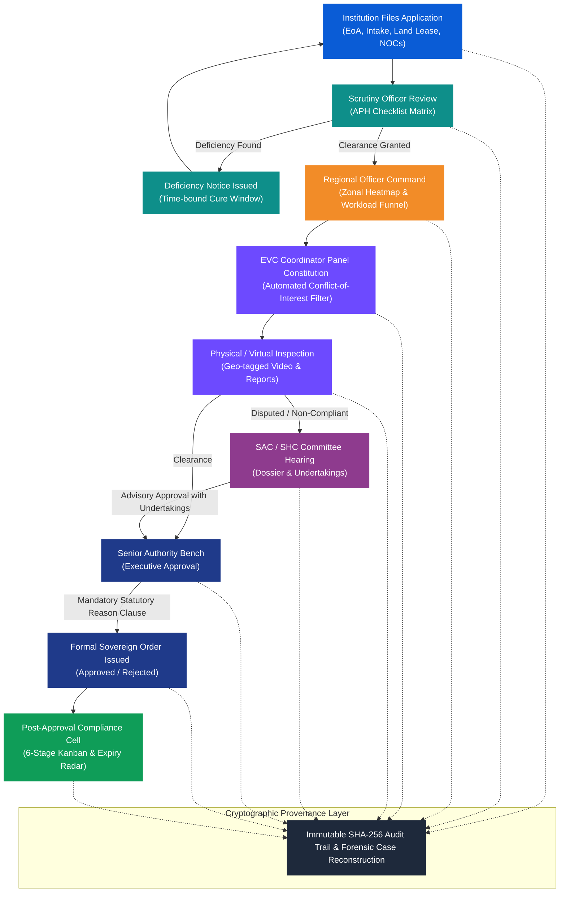

<div align="center">

  

  # AEGIS
  ### AICTE Approval & Compliance Management System

  *Transforming statutory higher-education regulation from fragmented bureaucratic silos into a unified, transparent, and cryptographically verified digital governance platform.*

  <p align="center">
    <a href="#-executive-summary"></a>
    <a href="#-the-10-dedicated-role-workbenches"></a>
    <a href="#-interactive-time-machine--sla-engine"></a>
    <a href="#-cryptographic-provenance--audit-trail"></a>
  </p>

  <p align="center">
    
    
    
    
    
    
    
  </p>

  ---

  > **Tagline:** *"Bringing every approval under control."*  
  > **Statutory Safeguard Principle:** *"Automated alerts support, but do not replace, statutory scrutiny and decisions of the competent authority."*

</div>

---

## 📌 Table of Contents

- [🏛️ Executive Summary](#-executive-summary)
- [⚡ The Problem vs. The AEGIS Standard](#-the-problem-vs-the-aegis-standard)
- [👥 The 10 Dedicated Role Workbenches](#-the-10-dedicated-role-workbenches)
- [🔬 Core Technical Innovations](#-core-technical-innovations)
  - [1. Interactive Time Machine & Reactive SLA Engine](#1-interactive-time-machine--reactive-sla-engine)
  - [2. Automated Conflict-of-Interest Guard for EVC Panels](#2-automated-conflict-of-interest-guard-for-evc-panels)
  - [3. Concentric Document Expiry Radar & 6-Stage Kanban](#3-concentric-document-expiry-radar--6-stage-kanban)
  - [4. Cryptographic Provenance & Forensic Case Reconstruction](#4-cryptographic-provenance--forensic-case-reconstruction)
  - [5. Visual Node-Graph Workflow Studio](#5-visual-node-graph-workflow-studio)
  - [6. Strict Human-in-the-Loop Sovereign Signatures](#6-strict-human-in-the-loop-sovereign-signatures)
- [🗺️ Statutory Workflow Lifecycle](#-statutory-workflow-lifecycle)
- [⚙️ Repository Architecture](#-repository-architecture)
- [🚀 Quick Start Guide](#-quick-start-guide)
- [🎬 Demonstration Video & Chapters](#-demonstration-video--chapters)
- [⚖️ Compliance & Governance Standards](#-compliance--governance-standards)

---

## 🏛️ Executive Summary

Every year, thousands of technical and polytechnic colleges across India navigate the **Approval Process Handbook (APH)** lifecycle governed by the **All India Council for Technical Education (AICTE)**. Applications encompass **Extension of Approval (EoA)**, establishment of new institutions, introduction of emerging technology courses, faculty intake revisions, and closure proceedings.

Traditional workflows rely on disconnected portals, manual document checks, physical dossiers, and unmonitored undertaking affidavits. **AEGIS** orchestrates the entire statutory regulatory journey into a unified, event-driven web application tailored for **10 real-world stakeholder roles**—enforcing strict SLA accountability, preventing conflicts of interest, automating document expiration vigilance, and locking every state change into an immutable SHA-256 audit chain.

---

## ⚡ The Problem vs. The AEGIS Standard

| Problem in Conventional System | The AEGIS Digital Governance Standard |
| :--- | :--- |
| **Opaque Multi-Stage Pendency**<br>Applications get stranded between Scrutiny, Regional Offices, EVC, and SAC/SHC without clear visibility into bottleneck locations. | **Real-Time Funnels & Cross-Regional Heatmaps**<br>Interactive SVG India heatmaps, stage-wise processing funnels, and officer workload swimlanes with single-click case rebalancing. |
| **Document Expiry Blindspots**<br>Mandatory statutory documents (30-year registered land lease deeds, municipal fire safety NOCs) lapse silently mid-cycle. | **Concentric Expiry Radar**<br>Continuous 30, 60, and 90-day expiration horizons with color-coded countdown gauges and automated institution reminder dispatches. |
| **Subjective Inspection Panel Allocation**<br>Manual constitution of Expert Visiting Committees (EVC) risks regional bias or institutional familiarity. | **Automated Conflict-of-Interest Guard**<br>Algorithmic verification blocks experts affiliated with the same state, district, or parent university from inspecting candidate institutions. |
| **Unenforced Post-Approval Undertakings**<br>Conditional approvals granted on time-bound affidavits (e.g., *"recruit Ph.D. faculty within 90 days"*) are filed in PDFs and forgotten. | **6-Stage Undertakings Kanban Engine**<br>Dynamic Kanban board (Open &rarr; Due Soon &rarr; Submitted &rarr; Verified &rarr; Overdue &rarr; Escalated) tracking compliance evidence to completion. |
| **Courtroom Vulnerability**<br>Regulatory decisions challenged in High Courts or the Supreme Court often suffer from fragmented, disputed administrative paper trails. | **Cryptographic SHA-256 Provenance**<br>Every action, role switch, document submission, and decision is cryptographically chained in an immutable audit ledger with a time-scrubbed case reconstructor. |

---

## 👥 The 10 Dedicated Role Workbenches

AEGIS replaces one-size-fits-all software with **10 purpose-built user interfaces**, each adapted to the exact operational responsibilities of the official:

```
┌───────────────────────────────────────────────────────────────────────────────────────────────────┐
│                                       AEGIS UNIFIED PLATFORM                                      │
├───────────────────┬───────────────────┬───────────────────┬───────────────────┬───────────────────┤
│  01. Institution  │   02. Scrutiny    │   03. Regional    │    04. Bureau     │     05. EVC       │
│      Portal       │      Officer      │      Officer      │      Officer      │    Coordinator    │
│  (Action Centre)  │ (Checklist Matrix)│  (Zonal Heatmap)  │  (National Pulse) │  (Conflict Guard) │
├───────────────────┼───────────────────┼───────────────────┼───────────────────┼───────────────────┤
│   06. Committee   │  07. Compliance   │   08. Senior      │    09. System     │   10. Statutory   │
│      Member       │      Officer      │    Authority      │   Administrator   │      Auditor      │
│  (Appeal Dossier) │  (Kanban & Radar) │ (Sovereign Sign)  │  (Visual Studio)  │ (Forensic Ledger) │
└───────────────────┴───────────────────┴───────────────────┴───────────────────┴───────────────────┘
```

### Detailed Persona & Portal Matrix:

| # | Role & Portal | Route | Official Persona | Core Capabilities & UI Signature |
| :-: | :--- | :--- | :--- | :--- |
| **1** | **Institution Portal** | `/institution` | **Dr. Ramesh Gupta**<br>*Principal & Head of Institution* | **Compliance Health Ring (0–100 gauge)**, urgent attention carousel for expiring leases/NOCs, step-by-step application stage stepper, and Prescribed Documents & Lease Vault. |
| **2** | **Scrutiny Officer** | `/scrutiny` | **Er. Vikram Deshmukh**<br>*Senior Scrutiny Officer (WRO)* | **Split-Pane Verification Desk** with ageing heat-strips, statutory checklist evaluation matrix (Pass/Deficient/NA with remarks), and one-click Electronic Case Summary generator. |
| **3** | **Regional Officer** | `/regional` | **Dr. Sunita Sharma**<br>*Regional Officer (WRO)* | **Interactive India SVG Regional Heatmap** across 5 zones (North, South, East, West, Central), stage-wise processing funnel, and officer workload swimlanes with case reassignment. |
| **4** | **Bureau Officer** | `/bureau` | **Shri Rajeev Verma**<br>*Advisor & Head (Approval Bureau)* | **National Pulse Command Dashboard**, comparative regional bar race chart, cross-regional pendency trendlines, and persistent national alerts rail. |
| **5** | **EVC Coordinator** | `/evc` | **Prof. Amitava Bose**<br>*National EVC Coordination Officer* | **Automated Conflict-of-Interest Guard** (flags and excludes panellists from same state/university), inspection scheduling queue, and statutory timeline Gantt calendar. |
| **6** | **Committee Member** | `/committee` | **Dr. K. S. Radhakrishnan**<br>*Chairman, Standing Appellate Committee* | **Digital Hearing Dossier Reader** with side-by-side evidence inspection, advisory recommendation editor, and time-bound undertakings conditions builder. |
| **7** | **Compliance Officer** | `/compliance` | **Smt. Meenakshi Sundaram**<br>*Director, Quality & Compliance Cell* | **6-Stage Undertakings Kanban Board**, concentric lease/NOC expiry radar (30/60/90 days), bulk reminder engine with penalty warnings, and evidence verification drawer. |
| **8** | **Senior Authority** | `/authority` | **Prof. T. G. Sitharam**<br>*Chairman, AICTE* | **Executive Council Briefing**, decisions shelf for formal sanctions, and **Mandatory Statutory Reason Clause** (strict human-in-the-loop sovereign decision enforcement). |
| **9** | **System Administrator** | `/admin` | **Arun Kumar**<br>*Lead System Architect & Policy Admin* | **No-Code Visual Node-Graph Workflow Designer** with animated live trace simulation, SLA threshold tuning sliders per stage, and multi-level escalation ladders. |
| **10** | **Statutory Auditor** | `/auditor` | **Justice (Retd.) B. N. Srikrishna**<br>*Statutory Transparency Auditor* | **Read-Only Forensic Audit Ledger**, tamper-evident SHA-256 cryptographic chain verifier, provenance explorer, and Case Reconstruction Playback Scrubber. |

---

## 🔬 Core Technical Innovations

### 1. Interactive Time Machine & Reactive SLA Engine
* Fast-forwards the platform's simulated statutory clock by **+7 days**, **+30 days**, or arbitrary dates.
* When advanced, the reactive SLA engine automatically evaluates active applications against configured stage timelines, flips ageing badges from normal to amber/overdue, triggers escalation ladders, and dispatches notices directly into user notification trays.

### 2. Automated Conflict-of-Interest Guard for EVC Panels
* Prior to dispatching an Expert Visiting Committee (EVC), the system automatically validates panellist demographics against the applicant institution.
* Any expert residing in the same geographic state, sharing an affiliating university, or possessing declared institutional conflicts is strictly barred from selection, preserving inspection neutrality.

### 3. Concentric Document Expiry Radar & 6-Stage Kanban
* **Expiry Radar:** Visualizes mandatory institutional instruments (30-year registered land lease deeds, municipal fire safety certificates, building occupancy NOCs) inside concentric 30, 60, and 90-day horizon rings.
* **Undertakings Kanban:** Organizes post-approval commitments into six distinct states (`Open` &rarr; `Due Soon` &rarr; `Submitted` &rarr; `Verified` &rarr; `Overdue` &rarr; `Escalated`), requiring verified photographic/documentary evidence before an undertaking can be archived.

### 4. Cryptographic Provenance & Forensic Case Reconstruction
* Every state transition, role switch, document upload, checklist evaluation, and order generation creates an audit block with an immutable SHA-256 hash mathematically linked to the previous block.
* If any record in the ledger is modified, the cryptographic chain breaks visibly.
* The **Case Reconstruction Scrubber** allows statutory auditors, ombudsmen, or High Court registrars to dial back time and inspect the exact state of any application at any historical moment.

### 5. Visual Node-Graph Workflow Studio
* Allows AICTE policy administrators to modify statutory approval routing diagrams visually (e.g., adding re-scrutiny gates or mandatory legal clearances) to match changes in annual Approval Process Handbooks without redeploying code.

### 6. Strict Human-in-the-Loop Sovereign Signatures
* Automated intelligence and algorithmic checklists **advise**, but **never decide**.
* Final sanctions or rejections can only be executed by authorized human authorities and strictly enforce typing a legal statutory reason before generating digital orders.

---

## 🗺️ Statutory Workflow Lifecycle



---

## ⚙️ Repository Architecture

```
d:\SIH 2026\
├── frontend/                         # Pure AEGIS React 19 + TypeScript + Vite SPA
│   ├── src/
│   │   ├── app/                      # Main App router, Landing hub, RoleRouteGuard
│   │   ├── config/                   # 10 role definitions & institutional parameters
│   │   ├── engine/                   # SLA calculator, SHA-256 hash chaining engine
│   │   ├── mock/                     # Seeded institutional data, applications, audit logs
│   │   ├── roles/                    # 10 specialized role portal views:
│   │   │   ├── admin/                # Configuration Studio & Node Graph Designer
│   │   │   ├── auditor/              # Forensic Audit Explorer & Case Reconstructor
│   │   │   ├── authority/            # Executive Overview & Sovereign Decisions Shelf
│   │   │   ├── bureau/               # Bureau Control Room & Comparative Bar Race
│   │   │   ├── committee/            # Committee Desk & Appeal Hearing Dossiers
│   │   │   ├── compliance/           # Compliance Tracker, Kanban & Expiry Radar
│   │   │   ├── evc/                  # EVC Scheduler & Conflict-of-Interest Guard
│   │   │   ├── institution/          # Institution Portal, Health Ring & Lease Vault
│   │   │   ├── regional/             # Regional Command View & India SVG Heatmap
│   │   │   └── scrutiny/             # Scrutiny Workbench & Checklist Matrix
│   │   ├── shared/                   # Header, AuditDrawer, CommandPalette, TimeMachine
│   │   ├── store/                    # Unified Zustand reactive state store
│   │   ├── types/                    # Domain models, enum definitions, interfaces
│   │   ├── main.tsx                  # Application entry point
│   │   └── index.css                 # Modern Government design system & Tailwind styles
│   ├── public/                       # Shield branding icons & web player
│   └── package.json                  # Dependencies: Lucide icons, Zustand, Date-fns
├── backend/                          # Optional FastAPI statutory microservice
│   ├── app/                          # API endpoints, authentication, document forensics
│   ├── rules/                        # APH statutory evaluation rule definitions
│   └── requirements.txt              # FastAPI, SQLAlchemy, Uvicorn, PyPDF2
├── watch_demo.html                   # Zero-dependency browser player with role chapters
├── generate_synced_demo.py           # Native Playwright Full HD video recorder
├── AEGIS_Demo_Walkthrough.mp4        # 1080p Full HD synchronized demonstration video
├── render.yaml                       # One-click cloud deployment blueprint
└── README.md                         # Comprehensive platform documentation
```

---

## 🚀 Quick Start Guide

### Prerequisites
* **Node.js** (v18.0 or higher) & **npm**
* **Python** (v3.10 or higher) *(only required for optional backend microservice)*

### 1. Launching the Frontend (AEGIS Modern Government Portal)
The frontend includes an in-browser mock statutory API, allowing the full 10-role experience, time machine, and audit ledger to run client-side without external database setup:

```bash
# Navigate to frontend directory
cd frontend

# Install dependencies
npm install

# Start development server
npm run dev
```

Open **`http://localhost:5173`** in your browser.

* To switch between roles, use the **Landing Page (`/`)** or the **Role Switcher dropdown** in the top navigation bar.
* Use `Cmd+K` or `Ctrl+K` to open the **Statutory Command Palette** for instant role switching and application lookups.

### 2. Optional: Launching the Python FastAPI Backend
If connecting to the forensic document processing microservice:

```bash
# Navigate to backend directory
cd backend

# Install dependencies
pip install -r requirements.txt

# Start backend server on port 8000
uvicorn app.main:app --reload --port 8000
```

Interactive API documentation will be available at **`http://localhost:8000/docs`**.

---

## 🎬 Demonstration Video & Chapters

A Full HD (1920&times;1080) walkthrough video is provided, synchronized down to the exact millisecond with professional voiceover cues and zero intrusive pop-ups:

- **Local Web Player:** Double-click [`watch_demo.html`](watch_demo.html) to open the interactive player with instant chapter seeking.
- **Direct Video File:** [`AEGIS_Demo_Walkthrough.mp4`](AEGIS_Demo_Walkthrough.mp4) (Duration: **3m 15s**, Full HD 1080p @ 25 fps).

### Synchronized Chapter Breakdown:

| Timestamp | Role / Portal Demonstrated | Key Features Covered |
| :---: | :--- | :--- |
| **0:00 – 0:20** | **AEGIS Landing Hub** | Clean Indian Government visual design, Ashoka Chakra watermark, and 10 standardized role cards. |
| **0:20 – 0:41** | **Role 1: Institution Portal** | 88/100 Compliance Health Ring, urgent 21-day lease renewal alert, and 30-year lease vault. |
| **0:41 – 0:56** | **Simulated Clock Engine** | Fast-forwarding time (`+7d`), reactive SLA escalations, and live notification drawer alerts. |
| **0:56 – 1:13** | **Role 2: Scrutiny Officer** | Queue ageing heat-strips, statutory checklist matrix (Pass/Deficient/NA), and electronic case summary. |
| **1:13 – 1:26** | **Role 3: Regional Officer** | Interactive SVG India regional heatmap, stage funnel, and officer workload swimlanes. |
| **1:26 – 1:38** | **Role 4: Bureau Officer** | National Pulse dashboard, regional comparison bar race chart, and live alerts rail. |
| **1:38 – 1:50** | **Role 5: EVC Coordinator** | Statutory delay alerts, automated Conflict-of-Interest panel guard, and Gantt inspection timeline. |
| **1:50 – 2:04** | **Role 6: Committee Member** | SAC/SHC appeal dossiers, advisory opinion editor, and time-bound undertakings conditions builder. |
| **2:04 – 2:17** | **Role 7: Compliance Officer** | 6-stage undertakings Kanban, concentric document expiry radar (30/60/90 days), and reminder dispatch. |
| **2:17 – 2:32** | **Role 8: Senior Authority** | Executive Council briefing, decisions shelf, and strictly enforced statutory reason requirement. |
| **2:32 – 2:47** | **Role 9: System Administrator** | Visual node graph workflow designer, animated execution trace, and SLA threshold tuning sliders. |
| **2:47 – 3:06** | **Role 10: Statutory Auditor** | Immutable SHA-256 hash chains, forensic audit explorer, and case reconstruction replay scrubber. |
| **3:06 – 3:15** | **Brand Outro & Safeguard** | AICTE sovereign decision preservation clause and final governance wrap-up. |

---

## ⚖️ Compliance & Governance Standards

AEGIS is engineered in compliance with statutory digital governance standards:
* **AICTE Approval Process Handbook (APH):** Native modeling of all norms, committee hearing pathways, and undertaking lifecycles.
* **National Informatics Centre (NIC) Design Guidelines:** High-contrast government visual identity, tricolour accents, and institutional typography.
* **WCAG 2.1 Level AA Accessibility:** Tested color contrast ratios, clear font scaling, and keyboard shortcut accessibility (`J`, `K`, `C`, `R` in Scrutiny).
* **Courtroom-Ready Defensibility:** Cryptographic SHA-256 hash chaining ensures that all regulatory orders and officer actions are tamper-evident and admissible in legal proceedings.

---

<div align="center">
  <sub>Built with precision for transparent, accountable, and sovereign statutory regulation.</sub><br/>
  <sub>© 2026 AEGIS Platform · AICTE Approval & Compliance Management System</sub>
</div>
